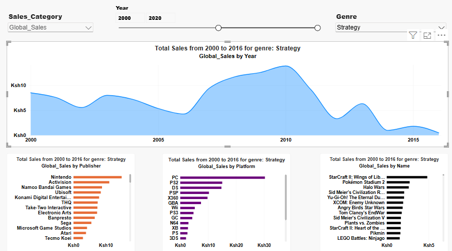

# Video Game Sales Analytics Dashboard

An interactive Power BI dashboard tracking global video game sales velocity, focusing on market distribution across publishers, genres, and platforms between 2000 and 2016.

## Tech Stack
* **Visualization & Analytics:** Microsoft Power BI
* **Data Transformation:** Power Query (M)
* **Data Formatting:** Localized variables mapped to KES (Ksh)

## Key Dashboard Insights
* **Platform Dominance:** PC completely outpaced console alternatives in the Strategy genre, peaking in total sales volume around 2010.
* **Publisher Performance:** Nintendo secured the dominant market share position within the selected timeframe, heavily anchored by major franchise titles like *Pokémon Stadium 2*.
* **Top Performing Titles:** *StarCraft II: Wings of Liberty* claims the highest sales record within the Strategy genre pipeline.

## Dashboard Preview

## Future Roadmap
The next development phase involves migrating this local file-based data tracking model into an automated engineering architecture:
1. **Extract:** Build a Python scripting layer to fetch multi-source gaming and financial metrics.
2. **Transform:** Deploy Pandas data cleaning modules to handle missing variables and normalize text strings.
3. **Load:** Stream structured records into a local PostgreSQL data warehouse layer for optimized SQL querying.
